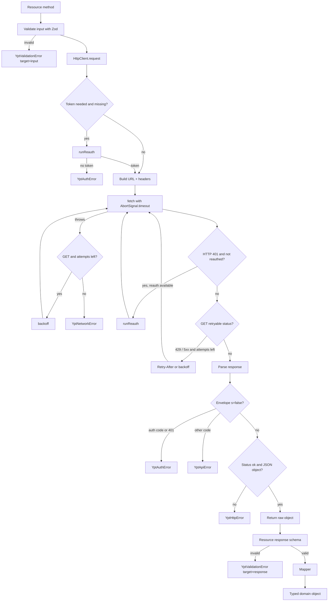

# Architecture & Internals

[← Documentation index](./overview.md)

This document explains how `ypt-js` is structured, how a request flows through the client,
and the invariants that keep the public API predictable. It is intended for contributors and
for consumers who need to reason about failure modes.

---

## 1. Design goals

| Goal                      | Implementation                                                                                          |
| :------------------------ | :------------------------------------------------------------------------------------------------------ |
| Predictable public models | A dedicated mapper layer converts every raw payload into camelCase domain types.                        |
| Fail before I/O           | Zod input schemas validate constructor options and method arguments.                                    |
| Detect API drift          | Lenient Zod response schemas with `.passthrough()` validate structure without rejecting unknown fields. |
| Be a polite client        | `GET`-only retries, exponential backoff with jitter, `Retry-After` support, low default concurrency.    |
| Stay dependency-light     | Only `zod`; native `fetch`; no test or HTTP framework at runtime.                                       |
| Be testable               | `fetch` and `now` are injectable; no module-level mutable state.                                        |
| Work everywhere           | ESM + CJS builds, Node 18+, full declarations.                                                          |

---

## 2. Module map

```text
src/
├── index.ts              public exports (client, schemas, types, helpers, errors)
├── client.ts             YptJs orchestrator: options, session, resource wiring
├── http.ts               HttpClient: URL/headers, timeout, retry, auth, envelope parsing
├── errors.ts             typed error hierarchy + AUTH_ERROR_CODES
├── schemas.ts            Zod input schemas + lenient raw response schemas
├── types.ts              raw wire interfaces + public domain interfaces
├── mappers.ts            raw → domain transformations and utilities
└── resources/
    ├── auth.ts           AuthResource: sign-in, social, splash, profile
    └── groups.ts         GroupsResource: discovery, membership, telemetry, moderation
```

### Responsibilities

| Module        | Owns                                                                        | Does not own          |
| :------------ | :-------------------------------------------------------------------------- | :-------------------- |
| `client.ts`   | Option validation, session state, resource construction, recovery wiring    | HTTP details, mapping |
| `http.ts`     | Transport, headers, timeouts, retries, 401 recovery hook, envelope decoding | Domain semantics      |
| `schemas.ts`  | Input constraints and raw response structure                                | Business logic        |
| `mappers.ts`  | Key normalization, coercion, live-time math, dedupe                         | Network               |
| `resources/*` | Endpoint paths, payload construction, response schema checks, orchestration | Transport internals   |
| `errors.ts`   | Classification and error payloads                                           | Recovery decisions    |

---

## 3. Construction and wiring

```ts
new YptJs(options)
  ├─ YptJsOptionsSchema.safeParse(options)     → YptValidationError on failure
  ├─ resolve fetch                              → globalThis.fetch or options.fetch
  ├─ store session fields (token/refresh/expiry)
  ├─ new HttpClient({
  │     baseUrl, fetch, userAgent, headers, timeoutMs,
  │     maxRetries, retryDelayMs,
  │     getToken: () => session.token ?? session.accessToken,
  │     authScheme
  │  })
  ├─ new AuthResource(http, session, setSessionCallback, language, device)
  ├─ new GroupsResource(http, now, cdnUrl)
  └─ if (credentials || refreshToken)
        http.reauthenticate = async () => {
          try splashLogin(refreshToken) → return on token
          fallback to signIn(credentials)
        }
```

Key points:

- The constructor is **synchronous and offline**.
- `session` is a single mutable object shared by `YptJs` and `AuthResource`.
- `http.getToken` reads the session through a closure, so rotations are visible immediately
  to the next request.
- The `reauthenticate` hook exists only when the caller supplied `credentials` or a
  `refreshToken`.
- `GroupsResource` captures `now` and `cdnUrl` at construction time.

---

## 4. Request lifecycle



### Details worth knowing

1. **Pre-flight auth.** For `auth: "token"` requests, the client checks for a token first.
   If missing, it runs recovery. If recovery yields nothing, it throws before calling
   `fetch`.
2. **One recovery flag per request.** `reauthed` is local; a second `401` is returned to the
   caller as `YptAuthError`.
3. **Shared recovery.** `runReauth` memoizes an in-flight promise, so parallel requests do
   not each authenticate.
4. **Retry accounting.** `attempt` increments only for network/`429`/`5xx` retries. The
   `401` retry does not consume a retry slot.
5. **Auth mode is explicit.** `"token"` sends `Authorization: <scheme> <token>`.
   `"bare"` sends just the scheme (sign-in/social). `"none"` omits it.
6. **`GET` vs `POST`.** `retriable` is hard-coded to `method === "GET"`.

---

## 5. Response pipeline

Each resource method performs three stages:

```text
HttpClient.parse        →  resource Zod check         →  mapper
(JSON envelope decode)     (lenient structure)           (coercion + domain)
```

### Why both `parse` and schemas?

- `HttpClient.parse` owns protocol-level rules: HTTP status, envelope errors, JSON shape.
- Resource schemas own _endpoint_ shape: which fields must exist for a safe mapping.
- Mappers own _semantics_: units, fallbacks, derived values.

Keeping them separate means a new endpoint can be added without touching transport, and a
transport bug cannot be hidden by a permissive mapper.

### Coercion philosophy

Upstream inconsistently sends numbers as strings. Mappers use small helpers:

```ts
num("14400"); // 14400
num(""); // null
str("  "); // null
```

Records missing a usable id are **skipped**, not fatal. The roster endpoint can return a
mixed/incomplete list; a single malformed member should not break the whole group.

---

## 6. Session and auth internals

### State ownership

`SessionState` is the single source of truth:

```ts
interface SessionState {
  token?: string;
  accessToken?: string;
  refreshToken?: string;
  expiresAt?: number;
  user?: YptUser;
}
```

`token` is a legacy alias kept in sync with `accessToken` by every writer. `getToken()`
prefers `token` then falls back to `accessToken`.

### State writers

| Writer                    | Effects                                                    |
| :------------------------ | :--------------------------------------------------------- |
| `signIn` / `socialSignUp` | Set access + refresh + expiry, set user, fire callbacks    |
| `splashLogin`             | Rotate access/refresh/expiry when returned, fire callbacks |
| `restoreSession`          | Set refresh token, then splash-login                       |
| `setToken`                | Set access token, fire callbacks                           |
| `setSession`              | Set provided fields, fire callbacks                        |
| `logout`                  | Clear all fields directly (**no callbacks**)               |

### Callback routing

`AuthResource` receives a callback typed as `(tokens: SetSessionTokens | string) => void`.
The client routes it to `setSession` for objects and `setToken` for strings. Public
`setToken`/`setSession` are the only places that emit `onTokenChange` and
`onSessionChange`.

### Recovery decision table

| `credentials` | `refreshToken` | Recovery wired | Order                                             |
| :-----------: | :------------: | :------------: | :------------------------------------------------ |
|      no       |       no       |       no       | Immediate `YptAuthError` when a token is required |
|      yes      |       no       |      yes       | sign-in                                           |
|      no       |      yes       |      yes       | splash rotation                                   |
|      yes      |      yes       |      yes       | splash rotation → sign-in fallback                |

---

## 7. Domain mapping

### Groups

`mapGroups` flattens four upstream buckets into one array, assigning role by bucket and
deduplicating ids with first-wins precedence (`ms` → `cs` → `gs` → `ps`).

### Members

`mapMember` supports two payload generations simultaneously:

| Concept       | Legacy                          | Modern                             |
| :------------ | :------------------------------ | :--------------------------------- |
| User id       | `ud` / `id`                     | `user_id` / `userId`               |
| Nickname      | `n`                             | `nickname`                         |
| Studying      | `dl.is`                         | `is_studying`                      |
| Today's time  | `dl.sm` (ms)                    | `today_study_seconds` (s → ×1000)  |
| Session start | `dl.ss` (epoch) / `dl.st` (ISO) | —                                  |
| Subject       | `dl.sn` / `dl.sb` / `dl.tt`     | `current_subject` object or string |
| Avatar        | `sd`/`si` + `hasCustomAvatar`   | `profile_image`                    |

Derived values:

```text
sessionElapsedMs = isStudying && start && now > start ? now - start : 0
liveStudyMs      = todayStudyMs + sessionElapsedMs
```

### Cross-group merge

`mergeMembers` is a pure function:

1. Index by `userId`.
2. First occurrence seeds group ids/names.
3. Later occurrences:
   - choose the active/unpaused record for telemetry, else the longer duration;
   - take `max(todayStudyMs)` and `max(liveStudyMs)`;
   - append group id/name.
4. Sort by `liveStudyMs` descending.

Pure and exported so consumers can reuse it on rosters fetched themselves.

---

## 8. Concurrency

`listAllMembers` uses a hand-rolled `settlePool`:

- At most `limit` promises in flight.
- Results are stored by original index.
- Failures are captured as `PromiseSettledResult` instead of aborting.
- If every group fails, the first error is rethrown.

Default limit is `3`. There is no global rate limiter; each client instance makes requests
as soon as you call methods.

---

## 9. Determinism and testability

| Seam                         | Purpose                                                  |
| :--------------------------- | :------------------------------------------------------- |
| `options.fetch`              | Mock network, add proxying/instrumentation, use `undici` |
| `options.now`                | Freeze time for live study calculations                  |
| `options.baseUrl` / `cdnUrl` | Point at a local fake or mirror                          |
| Pure mappers                 | Unit-test transformations without a client               |

The test suite (`test/`) follows the same approach: a `mockFetch` helper records calls and
returns scripted responses; no live requests are made.

---

## 10. Packaging and builds

`tsup.config.ts`:

- Entry: `src/index.ts`
- Formats: ESM (`dist/index.js`) + CJS (`dist/index.cjs`)
- Target: `es2022`
- Sourcemaps enabled, output cleaned each build
- Declarations emitted by `tsc -p tsconfig.build.json`, then copied to `index.d.cts`
  so CJS consumers get correct types.

`package.json` export map:

```json
{
  "import": { "types": "./dist/index.d.ts", "default": "./dist/index.js" },
  "require": { "types": "./dist/index.d.cts", "default": "./dist/index.cjs" }
}
```

`engines.node` is `>=18` because the client relies on global `fetch` and
`AbortSignal.timeout`.

---

## 11. Invariants

These should hold for every change:

1. Public methods never return raw upstream objects.
2. Every public method validates its input before performing I/O.
3. Every endpoint maps to a response schema; schemas stay lenient about unknown fields.
4. `POST` is never automatically retried.
5. At most one recovery attempt per request; concurrent recoveries are shared.
6. Session writes go through `setToken`/`setSession` (except `logout`, which is explicit).
7. Group ids are normalized and validated to prevent query injection.
8. Mappers never throw on individual malformed records; they skip them.
9. No module-level mutable state; multiple clients can coexist with different sessions.
10. `now` and `fetch` remain injectable.

---

## 12. Adding an endpoint

1. **Types** — add raw interfaces to `src/types.ts` and public domain interfaces beside
   them.
2. **Schema** — add a lenient raw schema in `src/schemas.ts` using `.passthrough()` and
   minimal required fields. Add an input schema if the method takes structured arguments.
3. **Mapper** — add a pure function in `src/mappers.ts`; coerce numeric strings with the
   existing helpers; skip records without ids.
4. **Resource method** — validate input, call `this.http.get/post`, validate the response,
   map, return.
5. **Exports** — re-export new public types/schemas from `src/index.ts`.
6. **Tests** — add a `mockFetch` case asserting the path, query/body, mapping, and error
   path. Never use live data; scrub PII.
7. **Docs** — update `docs/upstream-api.md`, `docs/api-reference.md`, and any relevant
   guide.

Checklist for auth mode:

- Sign-in/social → `"bare"`.
- Normal authenticated calls → `"token"` (default).
- Anonymous handshake when no token → `"bare"` (handled in `splashLogin`).

---

## 13. Known limitations

- No token persistence, encryption, or refresh scheduler.
- No global rate limiter or request queue.
- No pagination iterator for search.
- No chat history or study-log read APIs.
- `role` is asserted from upstream strings rather than validated.
- `expiresAt` is informational; expiry is handled reactively via `401`.
- `POST` operations are not retried.
- Upstream is undocumented and may change without notice; response validation is the
  canary.

---

## Related

- [API reference](./api-reference.md)
- [Upstream API](./upstream-api.md)
- [Contributing](./contributing.md)
- [Error handling](./error-handling.md)
