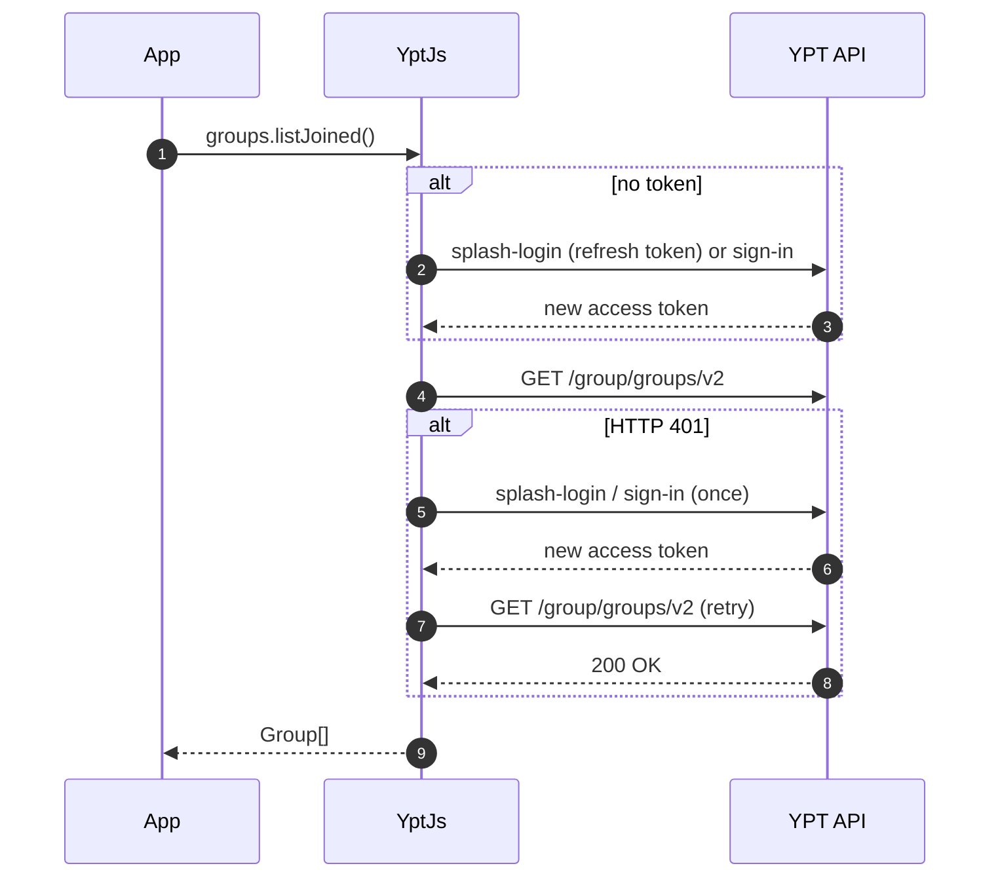

# Authentication & Session Lifecycle

[← Documentation index](./README.md)

YPT uses a **dual-token JWT** model. This guide explains how the client establishes a
session, how tokens rotate, how automatic recovery works, and what you must persist.

---

## 1. Session model

| Token          | Purpose                                                       | Lifetime    |
| :------------- | :------------------------------------------------------------ | :---------- |
| `accessToken`  | Sent as `Authorization: JWT <token>` on every authorized call | Short-lived |
| `refreshToken` | Exchanged through splash-login for a new token pair           | Long-lived  |
| `expiresAt`    | Access-token expiry timestamp, when upstream provides it      | —           |

The client stores all of this **in memory only**. It never writes tokens to disk, the
environment, or logs. Persistence is your responsibility via the change callbacks.

```ts
import { YptJs } from "ypt-js";

const ypt = new YptJs({ token, refreshToken, expiresAt });

ypt.accessToken; // string | undefined
ypt.token; // string | undefined (same value; legacy alias)
ypt.refreshToken; // string | undefined
ypt.expiresAt; // number | undefined
ypt.isAuthenticated; // boolean
ypt.user; // YptUser | undefined
```

> `isAuthenticated` means "the client currently holds a token", not "the token is valid".
> The client does not pre-empt expiry; it reacts to a `401` instead.

---

## 2. Signing in with email and password

```ts
const user = await ypt.auth.signIn(
  { email: "student@example.com", password: "MySecurePassword123!" },
  { splash: true, strictPasswordValidation: false },
);
```

### Behavior

1. Validates `email` (format) and `password` (non-empty). Invalid input throws
   `YptValidationError` with `target: "input"` before any request.
2. If `strictPasswordValidation` is `true`, applies YPT's client-side password rules.
3. Sends `POST /user/sign-in-jwt` with the literal `Authorization: JWT` header (no token).
4. Normalizes either the legacy or modern response shape into a `YptUser`.
5. Stores `accessToken`, `refreshToken`, `expiresAt`, and the user on the session.
6. Unless `splash: false`, performs a splash-login handshake and returns `YptUser`.

### Request payload

```json
{
  "email": "student@example.com",
  "password": "MySecurePassword123!",
  "loginProvider": "Email",
  "new": true,
  "getx": true,
  "language": "en"
}
```

### Accepted response shapes

The client accepts both the legacy envelope and the modern dual-token shape:

```json
// Legacy
{ "s": true, "jwt": "…", "ud": 16300695, "n": "StudentBot", "e": "…", "today": "2026-10-13" }

// Modern
{
  "accessToken": "…",
  "refreshToken": "…",
  "expiresAt": 1730000000,
  "user": { "id": 1049281, "nickname": "HardWorker2026", "email": "…" }
}
```

If neither `accessToken` nor `jwt` is present, the call throws `YptApiError`.

> **Transactional note:** tokens are stored _before_ the splash handshake runs. If the
> handshake fails, `signIn` rejects but the session is already authenticated. Treat the
> thrown error as "handshake failed", not necessarily "login failed".

### `strictPasswordValidation`

YPT's client-side rules are:

- At least 8 characters.
- At least 2 of: uppercase, lowercase, digits, special characters.

```ts
import { validatePassword } from "ypt-js";

const check = validatePassword("mySecret123!");
// { valid: true }
```

---

## 3. Social sign-up / sign-in

```ts
const user = await ypt.auth.socialSignUp({
  provider: "GOOGLE",
  token: googleIdToken,
  nickname: "StudyWarrior",
  operatingSystem: "android", // default
  terms: true, // default
  privacy: true, // default
  ageOver14: true, // default
});
```

| Field             | Required | Notes                                                 |
| :---------------- | :------- | :---------------------------------------------------- |
| `provider`        | yes      | `KAKAO`, `NAVER`, `GOOGLE`, `APPLE`, `FACEBOOK`       |
| `token`           | yes      | OAuth access token, ID token, or Apple identity token |
| `nickname`        | yes      | Display name used if the account is created           |
| `operatingSystem` | no       | `"android"` (default) or `"ios"`                      |
| `terms`           | no       | Terms agreement, default `true`                       |
| `privacy`         | no       | Privacy agreement, default `true`                     |
| `ageOver14`       | no       | Age confirmation, default `true`                      |

Request: `POST /user/social/sign-up-jwt`

```json
{
  "provider": "GOOGLE",
  "token": "…",
  "nickname": "StudyWarrior",
  "operatingSystem": "android",
  "terms": true,
  "privacy": true,
  "age_over_14": true
}
```

The same token/splash lifecycle as email sign-in applies. If the response omits
`social_type`, the client fills it from `provider`.

---

## 4. Splash login

`POST /user/v2/splash-login` is YPT's device handshake. It is used to:

- Announce device metadata after a fresh login.
- Rotate an access token using a refresh token.
- Restore a session without credentials.

```ts
// Handshake with the configured device defaults
const result = await ypt.auth.splashLogin();

// Rotate with a specific refresh token
const rotated = await ypt.auth.splashLogin({ refreshToken: savedRefreshToken });

// Override device fields
await ypt.auth.splashLogin({ device: { timezone: "Asia/Dhaka" } });
```

### Request body

```json
{
  "version": 810046,
  "pushToken": "",
  "timezone": "UTC",
  "deviceType": "WIN",
  "osVersion": 10,
  "deviceModel": "Desktop",
  "pv": 2,
  "language": "en",
  "refreshToken": "…"
}
```

`refreshToken` is included when one is available on the session or passed explicitly.
The `Authorization` header is `JWT <token>` when a token exists, otherwise the bare
scheme (`JWT`).

### Result

```ts
interface SplashLoginResult {
  success: boolean;
  accessToken?: string;
  refreshToken?: string;
  expiresAt?: number;
}
```

If the response contains a new `accessToken`, the client updates the session and fires
`onTokenChange` / `onSessionChange`. The returned `refreshToken` falls back to the one
that was sent when upstream does not rotate it.

> Unlike `restoreSession`, `splashLogin` **does not** throw when no token comes back. Check
> `result.accessToken` or `ypt.isAuthenticated` if you need that guarantee.

---

## 5. Restoring a session

Persist the refresh token from `onTokenChange` / `onSessionChange`, then restore on startup:

```ts
import { YptJs } from "ypt-js";

const saved = await loadTokens(); // { accessToken?, refreshToken }

const ypt = new YptJs({
  refreshToken: saved.refreshToken,
  onTokenChange: async (accessToken, refreshToken) => {
    await saveTokens({ accessToken, refreshToken });
  },
});

await ypt.auth.restoreSession(saved.refreshToken!);

if (!ypt.isAuthenticated) {
  // Fall back to interactive login.
}
```

`restoreSession(refreshToken, device?)`:

1. Rejects an empty/non-string token with `YptValidationError`.
2. Stores the token and performs splash-login.
3. Throws `YptAuthError` if neither the session nor the response holds an access token.

Because the constructor wires recovery when `refreshToken` is supplied, you can often skip
the explicit `restoreSession` call — the first API request will perform the handshake
lazily. Calling it explicitly gives you a clear failure point at startup.

---

## 6. Automatic re-authentication

The client recovers from exactly **one** `401` per request. It also signs in before the
first request when a token is missing but credentials or a refresh token were configured.



### Precedence

1. **Refresh token rotation** — if a refresh token exists, call splash-login.
2. **Credential sign-in** — if rotation fails or was unavailable, use `credentials`.
3. **Fail** — throw `YptAuthError`.

### Guarantees and limits

- Concurrent requests share a single in-flight recovery. Two parallel calls cannot trigger
  two logins.
- Only one recovery is attempted per request. A second consecutive `401` is surfaced as
  `YptAuthError`.
- Recovery is not attempted for sign-in/social calls themselves (`auth: "bare"`).
- Recovery is only wired when `credentials` or `refreshToken` was passed to the
  constructor.
- `expiresAt` is not used to refresh proactively. If you want to refresh before expiry,
  schedule it yourself and call `splashLogin`.

---

## 7. Persisting and updating the session

### Callbacks

```ts
const ypt = new YptJs({
  credentials: { email, password },
  onTokenChange(token, refreshToken) {
    // Called on sign-in, rotation, and manual setToken/setSession.
  },
  onSessionChange(session) {
    // session: { accessToken, refreshToken?, expiresAt?, user? }
  },
});
```

`onTokenChange` always receives the current access token and the current refresh token (if
any). `onSessionChange` receives a snapshot. Both fire after the in-memory session has been
updated.

### Manual setters

```ts
ypt.setToken("new-access-token");
ypt.setSession({ accessToken: "…", refreshToken: "…", expiresAt: 1730000000 });
```

Both setters fire the callbacks. Use them when you already manage rotation externally.

### Logout caveat

```ts
await ypt.auth.logout();
```

`logout` calls `POST /user/logout` and clears the in-memory session in a `finally` block.
That means local tokens are cleared even if the network call fails (the error still
propagates). **The callbacks are not fired by logout** — clear your persisted copy yourself:

```ts
try {
  await ypt.auth.logout();
} finally {
  await deletePersistedTokens();
}
```

---

## 8. Account and profile operations

```ts
// Is this nickname taken?
const taken = await ypt.auth.checkUsername("ExamMaster");

// Rename the current user (updates ypt.user.nickname)
await ypt.auth.updateNickname("ExamMaster2026");

// Update the study bio (updates ypt.user.statusMsg)
await ypt.auth.updateStatusMessage("Target: 10 hours daily");

// Exchange the YPT token for a Firebase custom token
const firebaseToken = await ypt.auth.getFirebaseCustomToken();

// Register an FCM/APNs device token
await ypt.auth.registerPushToken(fcmDeviceToken);
```

| Method                      | Endpoint                           | Notes                                                 |
| :-------------------------- | :--------------------------------- | :---------------------------------------------------- |
| `checkUsername(nickname)`   | `POST /user/exist-username`        | Returns `boolean` from `exist` / `isExist`            |
| `updateNickname(nickname)`  | `POST /user/nickname/change`       | Trims input; updates `client.user` on success         |
| `updateStatusMessage(text)` | `POST /user/status_msg/change`     | Sends both `status_msg` and `statusMsg` keys          |
| `getFirebaseCustomToken()`  | `POST /user/firebase/custom-token` | Returns `token \| customToken \| firebaseCustomToken` |
| `registerPushToken(token)`  | `POST /user/push-token`            | Sends `{ token, pushToken }`                          |
| `logout()`                  | `POST /user/logout`                | Always clears local session                           |

---

## 9. Auth error codes

YPT returns errors inside its JSON envelope: `{ "s": false, "c": <code>, "m": "<message>" }`.
The client maps the known auth codes to `YptAuthError`:

| Code  | Meaning (reverse-engineered) |
| :---- | :--------------------------- |
| `112` | Incorrect password           |
| `113` | Unknown email / account      |
| `114` | Suspended or blocked account |

`AUTH_ERROR_CODES` is exported if you want to branch on codes yourself:

```ts
import { AUTH_ERROR_CODES } from "ypt-js";
AUTH_ERROR_CODES.has(112); // true
```

Any `HTTP 401` is also surfaced as `YptAuthError`, regardless of envelope contents.
Other envelope errors become `YptApiError` (with `code`), and non-2xx responses without an
envelope become `YptHttpError`.

---

## 10. Security checklist

- Store credentials in a secrets manager or environment variables, never in source.
- Persist refresh tokens encrypted at rest; rotate them when `onTokenChange` provides a new
  value.
- Never log `client.token`, `refreshToken`, `expiresAt`, or the raw request bodies.
- Use a custom `fetch` to add observability, but redact the `Authorization` header.
- `credentials` is kept in memory for the lifetime of the client; construct the client per
  user/session and let it be garbage-collected.
- This is an unofficial client. Do not use it to access accounts or data you do not own.

---

## Related

- [Getting started](./getting-started.md)
- [Groups & telemetry](./groups.md)
- [Error handling](./error-handling.md)
- [API reference → AuthResource](./api-reference.md#3-authresource-clientauth)
