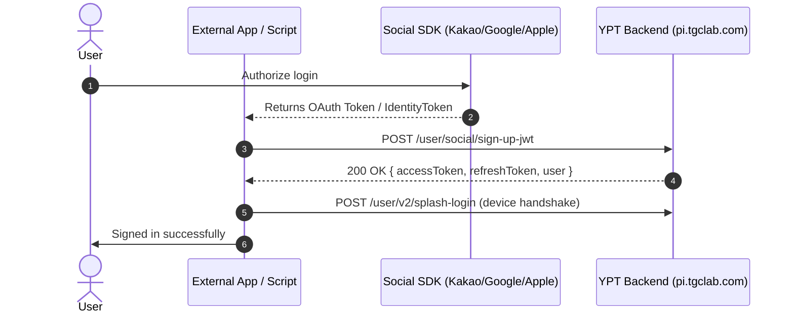

# Authentication & Session Lifecycle

This guide covers everything you need to know about authenticating with YPT, managing dual-token sessions, restoring sessions on application restart, integrating with Firebase, and performing user account operations.

---

## Overview of Auth Architecture

The YeolPumTa (YPT) mobile client uses a **Dual-Token JWT** authentication model:

- **Base URL**: `https://pi.tgclab.com` (Mainland China: `https://pi.pallo.cn`)
- **Tokens**:
  - `accessToken`: Used for every authorized API call in the `Authorization` header.
  - `refreshToken`: Long-lived token used to rotate and obtain a fresh `accessToken` without prompting the user for credentials.
  - `expiresAt`: Expiry epoch timestamp for the access token.
- **Storage**: In the official app, tokens are encrypted in Android Keystore via `flutter_secure_storage`. In `ypt-js`, you can persist them using the `onTokenChange` or `onSessionChange` hooks.

---

## 1. Email & Password Sign-In

Used when logging in with standard email and password credentials.

### Method Signature

```typescript
client.auth.signIn(
  params: SignInParams,
  options?: SignInOptions
): Promise<YptUser>
```

### Parameters

- **`params.email`** (`string`, required): User account email address. Validated with email regex format.
- **`params.password`** (`string`, required): Account password.
- **`options.splash`** (`boolean`, optional, default `true`): Runs the device handshake (`POST /user/v2/splash-login`) immediately after login.
- **`options.strictPasswordValidation`** (`boolean`, optional, default `false`): Enforces client-side password strength rules before making the request.

### Password Rules & Validation Helper

YPT applies client-side password complexity rules:

- Minimum 8 characters.
- Must contain characters from at least 2 categories:
  1. Uppercase letters (`A-Z`)
  2. Lowercase letters (`a-z`)
  3. Numbers (`0-9`)
  4. Special symbols (`!@#$%^&*...`)

You can test passwords using the exported helper:

```typescript
import { validatePassword } from "ypt-js";

const result = validatePassword("mySecret123!");
if (!result.valid) {
  console.error("Password does not meet YPT rules:", result.reason);
}
```

### Example: Email Login

```typescript
import { YptJs } from "ypt-js";

const ypt = new YptJs();

const user = await ypt.auth.signIn(
  {
    email: "student@example.com",
    password: "MySecurePassword123!",
  },
  { strictPasswordValidation: true },
);

console.log("Logged in user:", user.nickname);
console.log("Access Token:", ypt.token);
console.log("Refresh Token:", ypt.refreshToken);
```

### Upstream Endpoint Specification

- **Endpoint**: `POST /user/sign-in-jwt`
- **Headers**: `User-Agent: Dart/3.11 (dart:io)`, `Content-Type: application/json`
- **Response**:
  ```json
  {
    "accessToken": "eyJhbGciOiJIUzI1NiIsIn...",
    "refreshToken": "eyJhbGciOiJIUzI1NiIsIn...",
    "expiresAt": 1730000000,
    "user": {
      "id": 1049281,
      "email": "student@example.com",
      "nickname": "HardWorker2026",
      "status_msg": "Studying for exams",
      "profile_image": "https://picf.tgclab.com/users/1049281.jpg",
      "flames": 12,
      "tier": "GOLD",
      "created_at": "2024-03-15T08:30:00Z"
    }
  }
  ```

---

## 2. Social Sign-Up & OAuth

Used when authenticating or registering for the first time using an external OAuth provider.

### Supported Providers (`SocialProvider`)

- `"KAKAO"` – Kakao SDK OAuth token (`KakaoFlutterSdkPlugin`)
- `"NAVER"` – Naver Login access token (`FlutterNaverLoginPlugin`)
- `"GOOGLE"` – Google Sign-In ID Token (`GoogleSignInPlugin`)
- `"APPLE"` – Apple Sign-In Identity Token (`SignInWithApplePlugin`)
- `"FACEBOOK"` – Facebook OAuth Access Token (`FlutterFacebookAuthPlugin`)

### Sequence Flow



### Method Signature

```typescript
client.auth.socialSignUp(
  params: SocialSignUpParams,
  options?: SignInOptions
): Promise<YptUser>
```

### Parameters

| Field             | Type                 | Required | Description                                               |
| :---------------- | :------------------- | :------- | :-------------------------------------------------------- |
| `provider`        | `SocialProvider`     | **Yes**  | `"KAKAO" \| "NAVER" \| "GOOGLE" \| "APPLE" \| "FACEBOOK"` |
| `token`           | `string`             | **Yes**  | OAuth token, ID token, or Apple identityToken JWT.        |
| `nickname`        | `string`             | **Yes**  | Chosen display nickname for the account.                  |
| `operatingSystem` | `"android" \| "ios"` | No       | Client operating system (default: `"android"`).           |
| `terms`           | `boolean`            | No       | Agreement to Terms of Service (default: `true`).          |
| `privacy`         | `boolean`            | No       | Agreement to Privacy Policy (default: `true`).            |
| `ageOver14`       | `boolean`            | No       | Confirmation of age 14 or older (default: `true`).        |

### Example: Google Sign-Up

```typescript
import { YptJs } from "ypt-js";

const ypt = new YptJs();

// Authenticate using Google OAuth ID Token
const user = await ypt.auth.socialSignUp({
  provider: "GOOGLE",
  token: "eyJhbGciOiJSUzI1NiIsImtpZCI6...", // Google ID Token
  nickname: "StudyWarrior",
  operatingSystem: "android",
});

console.log("Registered Google user:", user);
```

---

## 3. Dual-Token JWT Lifecycle

### Token Properties on Client

Once authenticated, the following getters are available on [`YptJs`](file:///home/afnan/Projects/ypt-js/src/client.ts):

```typescript
ypt.token; // string | undefined (accessToken)
ypt.accessToken; // string | undefined (alias for token)
ypt.refreshToken; // string | undefined
ypt.expiresAt; // number | undefined (epoch timestamp)
ypt.isAuthenticated; // boolean (true if holding a valid token)
ypt.user; // YptUser | undefined
```

### Automatic 401 Re-Authentication Precedence

When an API request encounters an `HTTP 401 Unauthorized` or expired access token:

1. **Refresh Token Rotation**: If `refreshToken` is available in session, `HttpClient` automatically attempts to call `POST /user/v2/splash-login` with `refreshToken` to acquire a fresh `accessToken`.
2. **Credential Re-Login**: If refresh token rotation fails (or was never present), but `credentials: { email, password }` were supplied during client initialization, it falls back to a fresh `POST /user/sign-in-jwt`.
3. If neither succeeds, `YptAuthError` is thrown.

---

## 4. Session Restore & Token Rotation

When your application starts up, you can restore an existing session without re-prompting for email and password by exchanging a stored `refreshToken`.

### Restoring a Stored Session

```typescript
import { YptJs } from "ypt-js";

const savedRefreshToken = await loadStoredRefreshToken();

const ypt = new YptJs({
  refreshToken: savedRefreshToken,
  onTokenChange: (accessToken, refreshToken) => {
    // Save rotated tokens to disk or database
    saveTokens({ accessToken, refreshToken });
  },
});

// Explicit session restore handshake:
await ypt.auth.restoreSession(savedRefreshToken);

// Now authenticated and ready to make API calls:
const groups = await ypt.groups.listJoined();
```

### Method Specifications

- **`client.auth.restoreSession(refreshToken, device?)`**: Restores the session with the provided refresh token. Throws `YptAuthError` if the token has expired or is invalid.
- **`client.auth.splashLogin(params?)`**: Performs the device handshake with optional device overrides and token rotation.

---

## 5. Downstream Integrations

### Firebase Custom Token Exchange

YPT mobile uses Google Firebase (Firestore and Realtime DB) for real-time study presence and sync. YPT's backend exchanges your authenticated YPT JWT for a Firebase Custom Auth Token.

```typescript
const firebaseToken = await ypt.auth.getFirebaseCustomToken();

// You can now sign into Firebase client SDKs:
// await firebase.auth().signInWithCustomToken(firebaseToken);
```

- **Endpoint**: `POST /user/firebase/custom-token`

### Registering Push Tokens

Registers an FCM (Firebase Cloud Messaging) or APNs push device token with YPT:

```typescript
await ypt.auth.registerPushToken("dKz9...fcm_device_token...");
```

- **Endpoint**: `POST /user/push-token`

---

## 6. Account & Profile Management

The `auth` resource provides several convenience methods for managing the current user account:

```typescript
// 1. Check if a nickname is already registered:
const isTaken = await ypt.auth.checkUsername("ExamMaster");
console.log("Username taken:", isTaken);

// 2. Change your display nickname:
await ypt.auth.updateNickname("ExamMaster2026");
console.log("New nickname:", ypt.user?.nickname);

// 3. Update status message (study bio):
await ypt.auth.updateStatusMessage("Target: 10 hours daily!");
console.log("New status:", ypt.user?.statusMsg);

// 4. Logout (invalidates session on backend and clears in-memory tokens):
await ypt.auth.logout();
console.log("Authenticated:", ypt.isAuthenticated); // false
```
